<p align="center">
  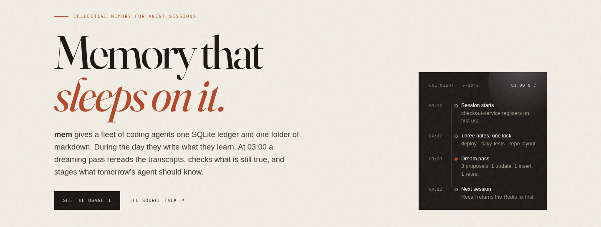
</p>

<h1 align="center">mem</h1>

<p align="center">
  <strong>Collective SQLite memory for agent sessions, with a nightly consolidation (“dream”) cycle.</strong><br>
  Zero runtime dependencies &middot; built on <code>node:sqlite</code> &middot; Node &ge; 22.5
</p>

<p align="center">
  <a href="https://nodejs.org"></a>
  <a href="package.json"></a>
  <a href="schema.sql"></a>
</p>

<p align="center">
  <a href="#quick-start">Quick start</a> &middot;
  <a href="#one-store-two-loops">The loops</a> &middot;
  <a href="#a-day-in-the-store">Usage</a> &middot;
  <a href="#the-0300-pass">The pass</a> &middot;
  <a href="#what-survives-the-night">Charts</a> &middot;
  <a href="#from-the-talk">The talk</a>
</p>

`mem` gives a fleet of coding agents one SQLite ledger and one folder of markdown. During the day they write what they learn and recall it in the next session. At 03:00 a dreaming pass rereads the transcripts, checks what is still true, and stages what tomorrow’s agent should know.

> [!NOTE]
> This is the visual guide. The full technical reference — schema, verbs, edge cases, fan-out details — is preserved in [docs/README.technical.md](docs/README.technical.md).

## Quick start

```console
$ node bin/mem.js init
$ node bin/mem.js session start --id s-001
$ node bin/mem.js remember --topic deploy --kind gotcha \
    --body "bin/setup needs a Redis instance on port 6379"
$ node bin/mem.js recall --limit 5
$ node bin/mem.js sync
```

`MEMORY_DB` overrides the database path (default `./memory.db`). `MEMORY_DIR` overrides the topic-file directory (default `./memory`).

<table>
  <tr>
    <td align="center" width="25%"><h3>0</h3><sub>runtime dependencies</sub></td>
    <td align="center" width="25%"><h3>8</h3><sub>core tables in the model</sub></td>
    <td align="center" width="25%"><h3>45d</h3><sub>confidence half-life</sub></td>
    <td align="center" width="25%"><h3>1</h3><sub>transaction to undo a night</sub></td>
  </tr>
</table>

<p align="center"><sub>Tap any diagram or chart to open it full size.</sub></p>

---

## One store, two loops

**Real time is small.** Agents write checkable notes while they work and recall them in the next session. **Batch time is a different process** with its own budget, its own visibility, and a diff you can reject.

| In-band · real time | Out-of-band · 03:00 |
|:--|:--|
| Agents `remember` and `recall` during a session. A per-file lock serialises live edits and nightly rewrites. | A batch agent reads the day’s transcripts and the current topic files, then proposes changes to memory. |

<p align="center">
  <a href="assets/readme/two-loops.svg">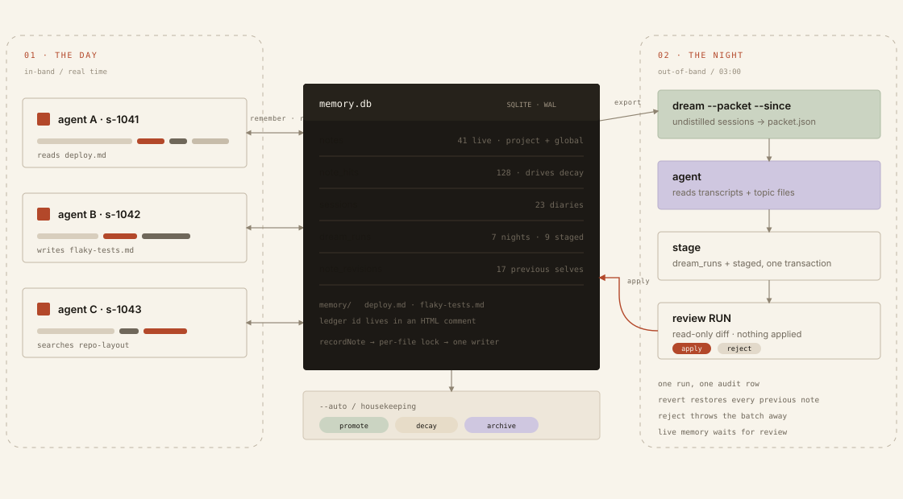</a>
</p>

<p align="center"><sub><b>Figure 1</b> — The day loop writes and retrieves; the night loop curates. Nothing destructive happens without a run id.</sub></p>

Every note is one row in `memory.db` and one bullet in a subject file such as `memory/deploy.md`. The ledger id rides along in an HTML comment, so the readable file and the database never drift apart:

```markdown
- <!-- mem {"id":12,"kind":"gotcha","confidence":0.72,...} --> `bin/deploy` needs `RAILS_ENV`.
  - Repro: `bin/setup`
  - Seen: 7 of 23 sessions (s-001, s-004)
```

Notes are scoped to **this project + global**, never another project’s memory. Each one carries a topic, a fingerprint, provenance, and a confidence. Usage decides survival: every recall records a hit, decay retires what nobody asks for, and promotion lifts a claim only after it is hit in two different projects.

> Dreaming is a second-order process over memory: it runs in batch, asynchronously, with its own allocated resources.
>
> — **Lamis Mukta**, AI Native DevCon 2026, 18:14

---

## A day in the store

Five commands carry the real-time loop. Output below is from a scratch run of this repository; paths are shortened and output is trimmed.

### 1 · Open the store. Start a session.

The first command in a new directory registers the project lazily. No patch to `try` is required.

```console
$ node bin/mem.js init
{
  "db": "./memory.db",
  "live": 0,
  "projects": 0,
  "sessions": 0
}

$ node bin/mem.js session start --id s-1042
{
  "session": "s-1042",
  "project": {
    "id": 1,
    "slug": "checkout-service",
    "status": "active",
    "created": true
  }
}

$ node bin/mem.js remember --topic deploy --kind gotcha \
    --body "bin/setup needs a Redis instance on port 6379." \
    --confidence 0.78
{
  "id": 1,
  "created": true,
  "topic": "deploy",
  "file": "memory/deploy.md"
}
```

### 2 · Ask for it back. Watch the score.

Recall reads this project plus global, ranks by confidence, recency, and use, and records a hit for every note it returns.

```console
$ node bin/mem.js recall --limit 3
[
  {
    "id": 3,
    "scope": "project",
    "kind": "convention",
    "body": "New CLI verbs are wired in src/cli.js and covered in test/mem.test.js.",
    "confidence": 0.84,
    "score": 0.84
  },
  {
    "id": 1,
    "kind": "gotcha",
    "body": "bin/setup needs a Redis instance on port 6379.",
    "confidence": 0.78,
    "score": 0.78
  },
  {
    "id": 2,
    "kind": "fact",
    "body": "test/queue.test.js times out when the suite runs in parallel; run npm test -- --test-concurrency=1.",
    "confidence": 0.66,
    "score": 0.66
  }
]

$ node bin/mem.js topics
{
  "project": "checkout-service",
  "topics": [
    { "topic": "deploy", "notes": 1 },
    { "topic": "flaky-tests", "notes": 1 },
    { "topic": "repo-layout", "notes": 1 }
  ]
}
```

After enrichment, the topic file carries the same note plus its evidence:

```markdown
# Deploy

<!-- generated by mem. write through `mem remember`, never by hand. -->

- <!-- mem {"id":1,"kind":"gotcha","confidence":0.78,"provenance":"session s-1042","topic":"deploy","version":1} -->
  bin/setup needs a Redis instance on port 6379; it exits 1 with ECONNREFUSED otherwise.
  - Repro: `bin/setup`
  - Seen: 5 of 9 sessions (s-1042)
```

> [!TIP]
> The body has to be checkable: a path, a command, a version, a specific gotcha. “Be careful with migrations” is a failed note. The HTML comment is the join key — erase the database and the file still knows which note it is.

### 3 · Stage the night. Read the diff. Commit it.

`stage` writes proposals to `staged` and stops. `review` is read-only. `apply` is deterministic and leaves a revision behind.

```console
$ node bin/mem.js dream stage candidates.json
{ "runId": 1, "staged": 3, "problems": [] }

$ node bin/mem.js dream review 1
dream run 1 — 3 proposals, not applied
```

<details>
<summary><b>See the full review — 3 proposals, read-only</b></summary>

```text
dream run 1 — 3 proposals, not applied

1. enrich: update  checkout-service / deploy / gotcha  confidence 0.92  -> note #1
   before:     bin/setup needs a Redis instance on port 6379; it exits 1 with ECONNREFUSED otherwise.
   after:      bin/setup needs a Redis instance on port 6379; it exits 1 with ECONNREFUSED. Start it with docker compose up -d redis.
   evidence:   s-1042 at bin/setup -> ECONNREFUSED 127.0.0.1:6379
   prevalence: 5 of 9 sessions
   provenance: session s-1042
   reason:     The failure recurred; the working start command is now known.

2. enrich: insert  checkout-service / deploy / fact  confidence 0.74
   note:       Migrations run inside the deploy container before traffic shifts; keep each migration backwards-compatible for one release.
   merges:     (new note)
   evidence:   s-1042 at Deploy 1841 rolled back: column rename broke the old pod
   prevalence: 2 of 9 sessions
   provenance: session s-1042
   reason:     Two rollbacks traced back to a non-compatible column rename.

3. verify: retire  checkout-service / fact  confidence 0.50  -> note #2
   note:       test/queue.test.js times out when the suite runs in parallel; run npm test -- --test-concurrency=1.
   evidence:   (none)
   prevalence: (not given)
   provenance: session s-1042
   reason:     queue v2 fixed the parallel timeout; the workaround is now wrong.
```

</details>

```console
$ node bin/mem.js dream apply 1
{
  "runId": 1,
  "inserted": 1,
  "updated": 1,
  "retired": 1,
  "applied": 3,
  "pending": 0,
  "distilled": 1
}

$ node bin/mem.js revisions --note 1 --limit 1
[
  {
    "note_id": 1,
    "version": 1,
    "cause": "update",
    "run_id": 1,
    "body": "bin/setup needs a Redis instance on port 6379; it exits 1 with ECONNREFUSED otherwise."
  }
]
```

**Run 1** staged 3, applied 3 · **1** updated · **1** inserted · **1** retired · **2** previous versions kept · **3** live notes after the night.

---

## The 03:00 pass

Dreaming is not a bigger prompt. It is a batch job with its own budget, its own visibility, and one job: make the memory better before the next session opens.

The packet carries the undistilled sessions and the current topic files. An agent reads all of it and proposes candidates: an insert, a merge into an existing note, an update with a known correction, or a retire. `stage` writes those proposals as one run. `review` shows the operation, the note it targets, the evidence, and the prevalence. Only `apply` changes live memory.

<p align="center">
  <a href="assets/readme/nightly-pass.svg">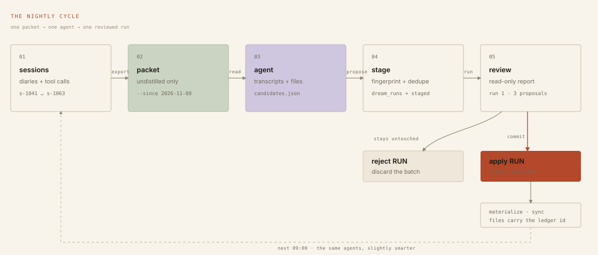</a>
</p>

<p align="center"><sub><b>Figure 2</b> — Stage and review are the boundary between proposal and memory. One transaction in, one transaction out.</sub></p>

<p align="center">
  <a href="assets/talk/dreaming-pass.jpg">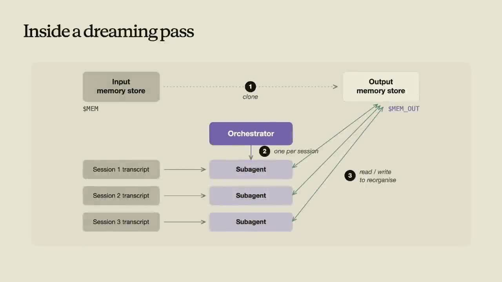</a>
</p>

<p align="center"><sub><b>From the talk</b> — Inside a dreaming pass, 22:00. Clone, one subagent per session, one output store.</sub></p>

### The three verbs

| Verb | What it does | Command |
|:--|:--|:--|
| **verify** | Stats every backticked path, reads the version a claim names, re-runs read-only commands. True claims keep their place; false ones are rewritten or dropped, with the reason and a revision behind them. | `mem dream verify [--execute]` |
| **organize** | Splits a topic past `--split-at`, merges names that converged (`deploy`/`deploys`), moves a claim to the subject it names, and cross-links related files. | `mem dream organize --split-at 20` |
| **enrich** | Adds what the transcripts taught: the reproducing command, prevalence (“3 of 12 sessions”), and the sessions that showed it. | `mem dream enrich --since …` |

> [!IMPORTANT]
> Only destructive work waits: a verify rewrite/drop, or any change that removes or replaces a claim, is staged and reviewed exactly like a dream run. Splits, moves, cross-links, and enrichment land automatically. `mem dream revert RUN` restores the previous note for every change the run made. `--auto` never applies a destructive verify unattended.

### Fan-out nights

One agent is not a fleet. `scripts/dream.sh` forks the live store, writes one transcript per undistilled session, and runs one agent per transcript in parallel. Agents propose candidates only; they never edit notes. `collect` merges duplicate facts across agents, drops a stale update when a later session proposes a newer one, and attributes every candidate to a session.

```console
# 1 · copy the store, keep the live one untouched
$ mem dream fork --path
/tmp/mem-fork-8f2c.db

# 2 · one transcript per undistilled session
$ mem dream transcripts --dir .scratch/dream/transcripts \
    --since 2026-11-09T00:00:00Z

# 3 · one agent per transcript, PARALLEL=4
$ MEM_AGENT=./agent mem dream propose --db "$MEM_OUT" \
    --session s-1042 .scratch/dream/candidates/s-1042.json

# 4 · merge, dedupe, attribute, then stage as one run
$ mem dream collect "$MEM_OUT"
$ mem dream review 7
```

Apply and reject both delete `$MEM_OUT`. A night that goes wrong is one deleted file away from never having happened.

---

## What survives the night

Two mechanics do most of the work: a recall score that lets use beat confidence, and a decay curve that retires what nobody asks for. Both use the constants in [`src/notes.js`](src/notes.js).

<p align="center">
  <a href="assets/readme/decay.svg">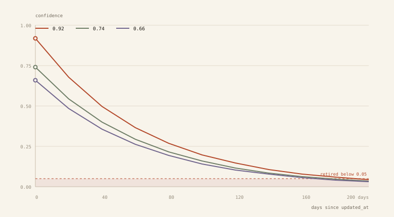</a>
</p>

<p align="center"><sub><b>Figure 3</b> — Decay with zero uses and no retrieval hits. The top note falls from 0.92 to 0.05 in 189 days; the 0.74 note takes 175 days.</sub></p>

`mem decay` sets confidence to **min(confidence, confidence × 2<sup>−age/45</sup> × (1 + ln(1 + uses)))** and retires anything below **0.05**. A retrieval hit lifts the recall score and keeps the note in front of agents, which is how it gets used again; a use also slows the decay through `use_count`.

<p align="center">
  <a href="assets/readme/recall-score.svg">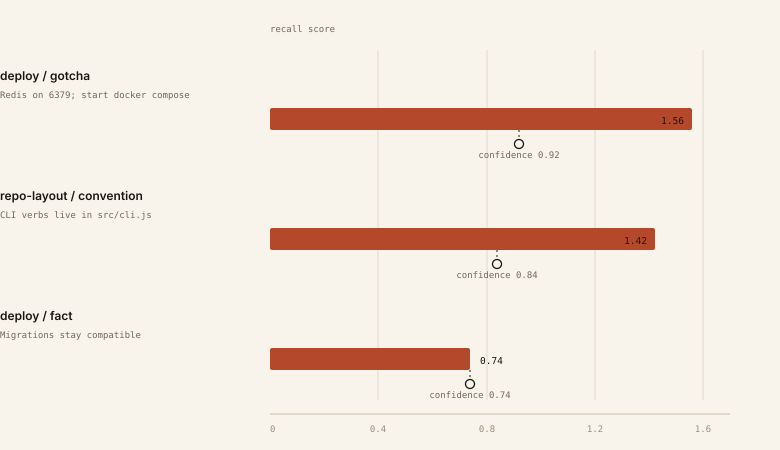</a>
</p>

<p align="center"><sub><b>Figure 4</b> — After one recall and one dream run. The 0.74 migration note has no hits yet, so its score is exactly its confidence.</sub></p>

```text
score = confidence × 2^(−age / 45) × (1 + ln(1 + uses) + 0.15 × ln(1 + hits))
```

That is the whole trick. Survival is not a property of the prose; it is a property of being asked for.

| Updated | Inserted | Retired | Applied |
|:--:|:--:|:--:|:--:|
| **1** | **1** | **1** | **3** |

<sub>Dream run 1 from the scratch project. Source: a local run of this repository on 2026-11-10.</sub>

---

## Small enough to read

No service, no vector database, no runtime dependencies. Node’s built-in SQLite, FTS5 search, and a single file plus its WAL siblings. Point `MEMORY_DB` anywhere and move on.

| Table | Role |
|:--|:--|
| `projects` | One row per try directory, registered lazily on the first session or note. |
| `notes` | The memory itself: scoped, topic’d, fingerprint-deduped, versioned. |
| `note_hits` | Every recall and use, with weight. Drives decay and cross-project promotion. |
| `sessions` | One row per agent session, carrying its diary and distill state. |
| `dream_runs` | The audit log of every night: counts, timestamps, source fork. |
| `staged` | Proposals waiting for review; applied as deterministic operations. |
| `run_sessions` | Which sessions a run was distilled from — the provenance of a night. |
| `note_revisions` | The previous self of every note that was updated, promoted, or reverted. |

<details>
<summary><b>Command reference</b></summary>

### The day

| Command | What it does |
|:--|:--|
| `mem remember --topic --kind` | Write a note through the lock; keep its id in the markdown file. |
| `mem recall [--query] [--limit]` | Rank this project + global and record a hit for each note returned. |
| `mem topics` · `mem sync` | List subject files, or rebuild them and the index from the ledger. |
| `mem session start\|end\|diary` | Open a session, attach a diary, distill it at night. |

### The night

| Command | What it does |
|:--|:--|
| `mem dream --packet --since` | Export undistilled sessions and current topic files as one packet. |
| `mem dream stage FILE` | Create a run and stage its proposals. Live memory is untouched. |
| `mem dream review RUN` | Print the diff: target, before/after, evidence, prevalence. |
| `mem dream apply\|reject\|revert` | Commit the run, throw it away, or restore every previous note. |
| `mem dream --auto` | Run verbs + promote, decay, archive. Destructive verify waits. |

### The fleet

| Command | What it does |
|:--|:--|
| `mem dream fork --path` | Copy the live store to a throwaway `$MEM_OUT`. |
| `mem dream transcripts` | Write one transcript per undistilled session. |
| `mem dream propose` | One agent, one session, candidates only — never note edits. |
| `mem dream collect MEM_OUT` | Merge duplicates, drop stale updates, attribute, stage one run. |

### The upkeep

| Command | What it does |
|:--|:--|
| `mem dream verify\|organize\|enrich` | The three verbs, each runnable on its own. |
| `mem promote` | Lift a claim hit in two different projects to global. |
| `mem decay` | Lower unused confidence; retire below 0.05. |
| `mem revisions --note ID` | Show what a note said before each update, promote, or revert. |

</details>

### Development

```console
$ npm run check   # eslint . + node --test test/
```

The JavaScript follows the 37signals house style through the local reference config; `npm run lint` is part of `check`.

---

## From the talk

Lamis Mukta, member of technical staff on Anthropic’s applied AI team, at AI Native DevCon, June 2026. Timestamps link into the video.

<p align="center">
  <a href="assets/talk/evolution.jpg">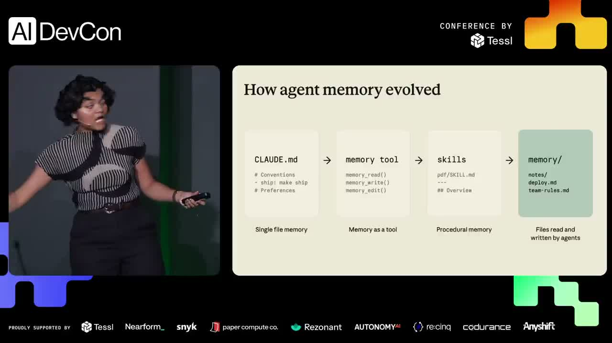</a>
</p>

<p align="center"><sub><b>How agent memory evolved</b> — 03:43 · single file → tool → procedural skill → files read and written by agents · <a href="https://youtu.be/tTcxVv8HHNw?t=223">watch</a></sub></p>

<table>
  <tr>
    <td width="50%" valign="top">
      <a href="assets/talk/versioning.jpg">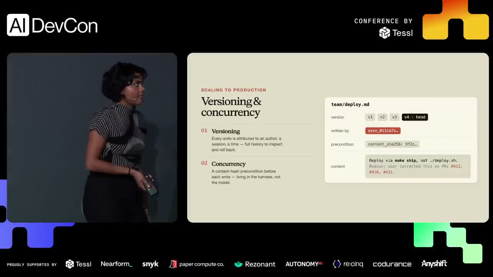</a>
      <sub><b>Versioning &amp; concurrency</b> — 10:45<br>Hash before, draft, hash again; if the hash moved, repull. <a href="https://youtu.be/tTcxVv8HHNw?t=645">watch</a></sub>
    </td>
    <td width="50%" valign="top">
      <a href="assets/talk/results.jpg">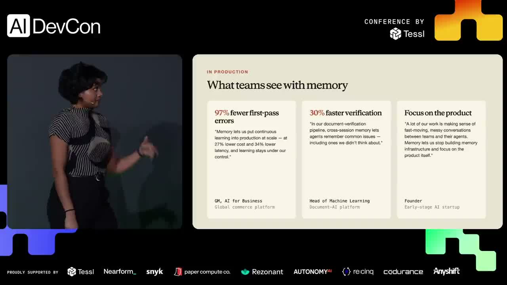</a>
      <sub><b>What teams see with memory</b> — 14:20<br>97% fewer first-pass errors, 30% faster verification. <a href="https://youtu.be/tTcxVv8HHNw?t=860">watch</a></sub>
    </td>
  </tr>
  <tr>
    <td width="50%" valign="top">
      <a href="assets/talk/permissions.jpg">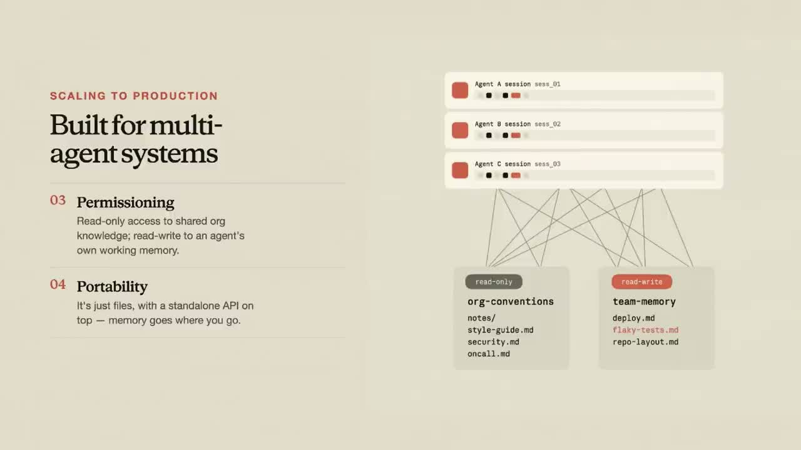</a>
      <sub><b>Built for multi-agent systems</b> — 13:00<br>Read-only org knowledge, read-write working memory. <a href="https://youtu.be/tTcxVv8HHNw?t=780">watch</a></sub>
    </td>
    <td width="50%" valign="top">
      <a href="assets/talk/dreaming.jpg">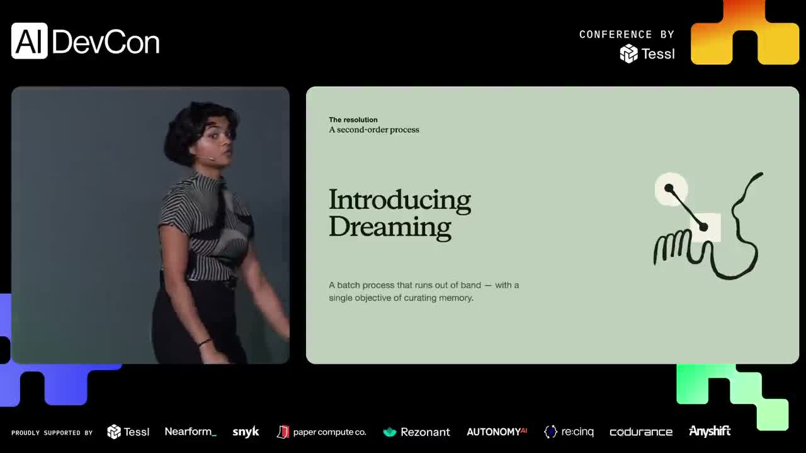</a>
      <sub><b>Introducing dreaming</b> — 18:15<br>A batch process out of band, with one objective: curating memory. <a href="https://youtu.be/tTcxVv8HHNw?t=1095">watch</a></sub>
    </td>
  </tr>
  <tr>
    <td width="50%" valign="top">
      <a href="assets/talk/takeaways.jpg">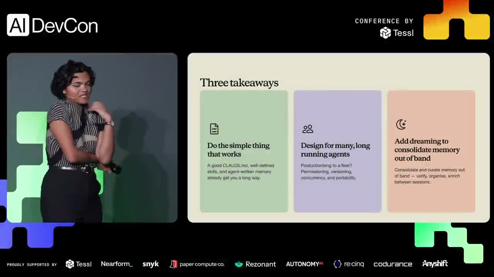</a>
      <sub><b>Three takeaways</b> — 25:15<br>Simple first; guardrails for many long-running agents; dream out of band. <a href="https://youtu.be/tTcxVv8HHNw?t=1515">watch</a></sub>
    </td>
    <td width="50%" valign="top">
      <a href="assets/talk/bottlenecks.jpg">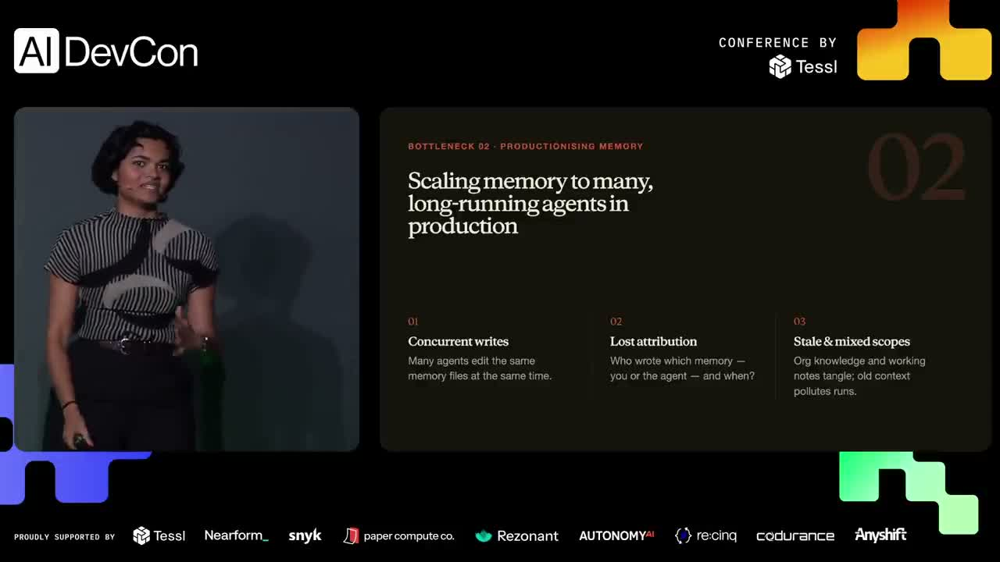</a>
      <sub><b>Bottlenecks in production</b> — 09:00<br>Concurrent writes, lost attribution, stale scopes. <a href="https://youtu.be/tTcxVv8HHNw?t=540">watch</a></sub>
    </td>
  </tr>
</table>

---

<p align="center">
  <em>Keep thinking. Keep learning.</em><br><br>
  <strong>Keep dreaming.</strong>
</p>

<p align="center"><sub>Lamis Mukta &middot; AI Native DevCon 2026 &middot; <a href="https://www.youtube.com/watch?v=tTcxVv8HHNw">watch the talk</a></sub></p>

---

<sub><b>mem</b> · collective SQLite memory with a nightly dreaming cycle · 2026 · Screenshots from <a href="https://www.youtube.com/watch?v=tTcxVv8HHNw">Lamis Mukta, AI Native DevCon 2026</a>, used for commentary and documentation.</sub>
